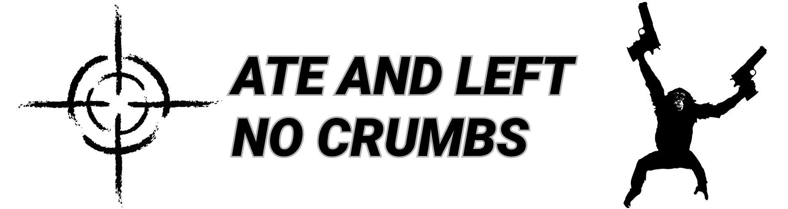

# GAMMA Hit Sounds



GAMMA Hit Sounds adds randomized S.T.A.L.K.E.R. G.A.M.M.A. impact audio to firearm injuries in RimWorld. It is made for RimWorld 1.6 and requires Harmony. Combat Extended compatibility is optional.

## Features

- Uses separate sound pools for armored and unarmored body hits, helmet hits, unhelmeted head hits, and mechanoid armor deflections.
- Chooses a random clip from the matching pool and limits regular hit sounds to one per pawn per game tick. Each pool contains 20 clips, except the unhelmeted head pool, which combines 20 gas-mask clips and 20 unarmored clips.
- Uses sharp armor on the struck body part to choose between the armored and unarmored pools. When Combat Extended is loaded, its partial apparel-armor value is used when available.
- Recognizes vanilla bullet damage and selected Combat Extended damage types: `Fragment`, `Tranquilizer`, `CE_Laser`, and `BulletToxic`.
- Suppresses the matching vanilla ground-impact sound and replaces bullet-related `Deflect_Metal` and `Deflect_General` cues with the mechanoid pool when that damage event did not produce a normal injury sound.
- Leaves direct mechanoid injury sounds to the base game and other loaded mods.

## Sound files

RimWorld loads the clips from folders referenced by `Defs/SoundDefs/Gamma_Hit_Sounds.xml`:

| Folder | Clips | Used for |
| --- | ---: | --- |
| `Sounds/Body/Armor` | 20 | Body parts covered by sharp armor |
| `Sounds/Body/NoArmor` | 20 | Body parts without sharp armor |
| `Sounds/Body/Mechanoid` | 20 | Replaced bullet-related armor deflections |
| `Sounds/Head/Helmet` | 20 | Head parts covered by sharp armor |
| `Sounds/Head/NoHelmet` | 40 | 20 gas-mask clips and 20 unarmored clips |

Clip names use the category's descriptive prefix and a two-digit sequence number. All 40 unhelmeted head clips follow the same `hit_head_no_helmet_XX.ogg` pattern.

## Build

The build requires the .NET SDK, the .NET Framework 4.7.2 Developer Pack, the RimWorld game assemblies, and Harmony's `0Harmony.dll`. Build with:

```powershell
dotnet build .\GammaHitSounds.csproj -c Release `
  -p:RimWorldDir="<RimWorld installation directory>" `
  -p:HarmonyDir="<directory containing 0Harmony.dll>"
```

`RimWorldDir` must point to the game installation directory. `HarmonyDir` must point to the directory containing `0Harmony.dll`. You can also set the `RIMWORLD_DIR` and `HARMONY_DIR` environment variables instead of passing these properties. A Release build writes `DHM.GammaHitEffects.dll` to `GAMMA hit sounds/Assemblies`.

## Credits and license

The sound effects are from S.T.A.L.K.E.R. G.A.M.M.A. The original hit-effects mod is by [wepl](https://www.moddb.com/mods/call-of-chernobyl/addons/wepls-hit-effects). Learn more about GAMMA at [stalkergamma.com](https://www.stalkergamma.com/).

The project source is licensed under the [MIT License](LICENSE).
